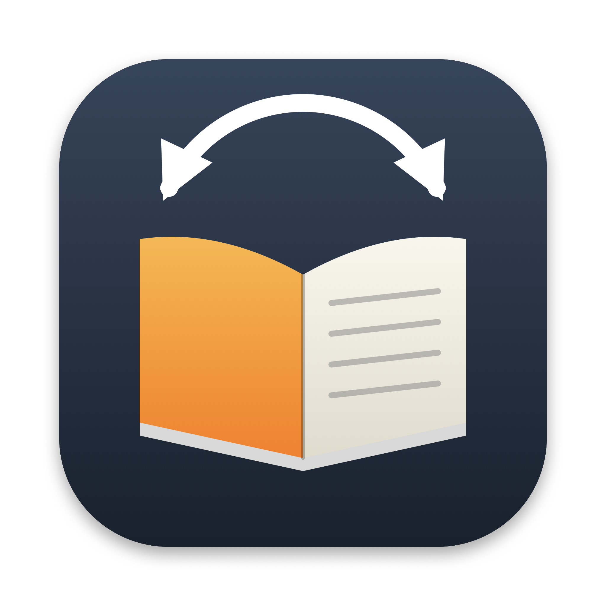

# Apple Kindle Bridge



Apple Kindle Bridge is a Mac app that keeps Apple Books and Kindle in step:
reading positions, highlights, notes, and the read state. It works through
Kindle for Mac and Amazon's cloud, so a stock Kindle device follows along.

Version 1.0 is a personal tool. It is signed ad hoc, not notarized.

## What it syncs

| | Apple Books → Kindle | Kindle → Apple Books |
|---|---|---|
| EPUB reading position | yes | yes |
| EPUB highlights, colors, notes (add, edit, delete) | yes | yes |
| PDF reading page | yes | no (Apple Books does not upload it) |
| PDF highlights and notes | yes | no |
| Read / finished state | yes | yes |
| Copy a book to the other side | Send to Kindle | KFX to EPUB with Calibre |

Store purchases with DRM are not copied. Tested on 2026-11-04 with macOS,
Kindle for Mac 7.70.1, and a Kindle Paperwhite 5 on firmware 5.19.2.

## Install

1. Download `Apple-Kindle-Bridge-1.0.zip` from the releases page and unzip it
   into `/Applications` or `~/Applications`.
2. The app is not notarized. Control-click it, choose Open, and confirm.
3. Install Kindle for Mac from the App Store and sign in.
4. On first launch the app downloads its tools (about 1.4 GB, mostly Calibre)
   into `~/Library/Application Support/Apple Kindle Bridge`.
5. Grant Full Disk Access and Accessibility to the app when onboarding asks.

See [Mac app](docs/app.md) for how each part works and its limits.

## Command line

The Python package also runs on its own:

```sh
python3 -m apple_kindle_bridge inspect
python3 -m apple_kindle_bridge export --output state/books.json
python3 -m apple_kindle_bridge positions state/books.json --output state/positions.json
```

Reports go to `state/`, which Git excludes because it holds private library data.

Position conversion needs the additional tools in the [setup instructions](docs/setup.md).

## Details

- [Mac app](docs/app.md)
- [Commands and synchronization rules](docs/usage.md)
- [KOReader service connection](docs/kosync.md)
- [Data handling and verification limits](docs/design.md)
- [Native reading-position transfer](docs/native-positions.md)
- [Native highlight transfer and limits](docs/native-highlights.md)
- [Highlight export and KOReader preview](docs/highlights.md)
- [Work plan](TODO.md)
- [Third-party code and licenses](third_party/positions/README.md)

## Tests

```sh
python3 -m unittest discover -s tests -q
```
